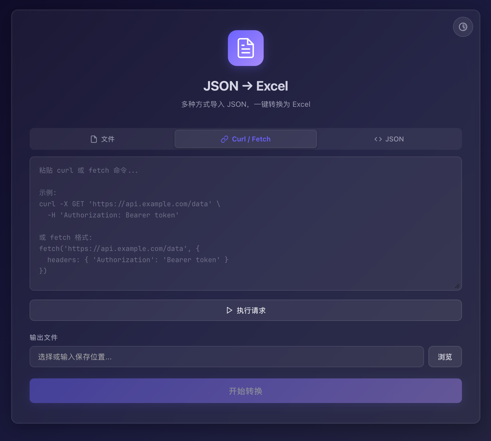

# JSON → Excel 转换工具 (json2excel-gui)

一个基于 **Tauri** + **Rust** 开发的高性能 JSON 转 Excel 桌面应用。提供极简的交互体验，支持多种数据导入方式，并能智能识别嵌套的 JSON 数组结构。




## 📖 使用说明

### 1. 导入数据
工具提供三种灵活的导入方式：
- **文件模式**：点击“浏览”选择本地 `.json` 文件。
- **Curl / Fetch 模式**：直接粘贴开发工具中的网络请求命令，点击“执行请求”即可获取实时数据。
- **JSON 模式**：直接在编辑器中粘贴或编写 JSON 字符串，点击“解析 JSON”。

### 2. 字段选择（高级功能）
如果 JSON 中包含多个数组（例如一个响应中有 `users` 和 `orders`），工具会弹出字段选择面板。你可以勾选需要导出的字段，每个选中的字段将对应 Excel 中的一个 **Sheet**。

### 3. 开始导出
确认 `.xlsx` 输出路径后，点击“开始转换”。若目标文件已存在，应用会再次请求确认替换；取消不会修改原文件。转换完成后，点击“在文件夹中显示”即可直接跳转到生成的 Excel 文件。

## 数据与导出规则

- **对象数组**：取所有行键的并集作为列，按键名排序；后续行新增字段不会遗漏。缺失字段留空，空记录和空字符串行仍保留行位置。非空数组若完全没有列（例如 `[{}]`），会明确报错。
- **矩阵**：同一个对象中的 `keys` + `values`（数组的数组）作为一张表。每行列数须与 `keys` 相同，其他兄弟数组仍可单独勾选导出。
- **不支持的数组**：标量数组、对象与非对象混合数组，以及不带 `keys` 的二维数组会明确报错，不会静默丢弃行。任一选中数据集无效时，整个导出失败，不发布部分结果。
- **空数组**：有意生成一张对应名称的空 Sheet；空矩阵仍保留 `keys` 表头。
- **精度**：粘贴内容不经过浏览器 `JSON.parse` / `JSON.stringify` 改写；后端保留任意精度 JSON 数字。Excel 中所有值均写为文本，长 ID 不会被 Excel 舍入，以 `=` 开头的字符串也不会变成公式。嵌套对象/数组保存为 JSON 文本，`null` 显示为 `<nil>`。
- **字段路径**：选择器使用 `root` 加 JSON Pointer 风格路径，例如 `root/users`；键中的 `/` 显示为 `~1`，`~` 显示为 `~0`，避免带点或斜杠的键与嵌套路径混淆。
- **Sheet 名**：不拆分 Unicode 字符，保守限制为 31 个 UTF-16 编码单元，替换 Excel 禁用字符，处理空名称、保留名和大小写/截短碰撞，自动添加不同后缀。
- **输出保护**：仅允许 `.xlsx` 目标，拒绝符号链接和源文件的硬链接/路径别名。先在同目录写完临时文件再发布；新目标不覆盖已有文件，替换已有目标须确认，并在替换前复查文件身份、内容摘要、大小及修改时间。请勿让其他程序同时改写同一个输出文件。
- **大小限制**：文件及粘贴 JSON 最大 64 MiB，最多 16,384 列及 1,048,575 条数据行（另有一行表头）；单元格遵循 Excel 的 32,767 字符限制，超限会报错而非截断。

## Curl / Fetch 支持范围

支持 Chrome 开发者工具常见的 **Copy as fetch**，包括单/双引号字符串、未加引号的选项键、转义和尾逗号，例如：

```js
fetch('https://api.example.com/data', {
  headers: { 'Content-Type': 'application/json', 'Authorization': 'Bearer token' },
  method: 'POST',
  body: '{"limit":10}',
});
```

- Fetch 只解析数据字面量，支持字符串 URL、`method`、字符串键值 `headers`、字符串或 `null` 的 `body`。**不会执行 JavaScript**，不支持变量、函数调用（含 `JSON.stringify`）、模板字符串、展开语法或其他表达式。
- Chrome 的 `mode`、`credentials`、`referrer`、`referrerPolicy`、`cache`、`priority` 等浏览器元数据可被读取，但不复现浏览器行为，也不会读取浏览器 Cookie/登录态；需要认证时请显式提供请求头。`keepalive`、空 `integrity`、`signal: null`、`redirect: 'error'/'manual'` 可接受；其他未知选项会报错。
- Curl 支持单个 HTTP(S) URL、`-X/--request`、`-H/--header`、`-d/--data`、`--data-raw`、`--data-binary`、直接键值的 `-b/--cookie`、`--url`、`--compressed` 和静默选项。支持 POSIX 引号和反斜杠续行，但不执行 shell 或展开环境变量。
- 禁止本地文件引用、curl 配置文件、输出参数、代理配置、多 URL、非 HTTP(S) 协议和手动传输控制头（如 Host/Content-Length）。`Accept-Encoding` 由客户端按可解压格式重新协商。
- 不自动跟随重定向，只接受成功 HTTP 状态和 UTF-8 JSON。一次仅执行一个请求，连接超时 10 秒、总时限 30 秒；命令最多 1 MiB、请求头最多 128 项/64 KiB、响应解压后最多 16 MiB。超限或不支持的语法会明确报错。

## ✨ 特性

- **🚀 多种导入方式**:
  - **文件模式**: 直接选择本地 `.json` 文件。
  - **粘贴模式**: 直接粘贴 JSON 文本。
  - **请求模式**: 支持粘贴 `curl` 或 `fetch` 命令，自动执行并解析接口返回的 JSON。
- **🔍 智能结构分析**:
  - 递归扫描对象中的数组字段（数组内部的嵌套数据作为单元格 JSON 保留）。
  - 支持 **Sheet 勾选**: 发现多个数组时，你可以选择将哪些字段导出为 Excel 的不同工作表（Sheet）。
  - 支持 **矩阵模式**: 自动识别 `keys` + `values` 的二维数据格式。
- **🎨 现代交互 UI**:
  - 丝滑的 **深色/浅色/跟随系统** 主题切换。
  - 转换完成后支持 **一键打开目录**。
  - 实时转换进度与错误提示。
- **⚡ 极速性能**: 后端采用 Rust 编写，使用 `rust_xlsxwriter` 库，处理大数据量时依然轻量迅捷。

## 🛠️ 技术栈

- **后端**: [Rust](https://www.rust-lang.org/) + [Tauri v2](https://tauri.app/)
- **Excel 生成**: [rust_xlsxwriter](https://github.com/jmcnamara/rust_xlsxwriter)
- **前端**: 原生 HTML / CSS / JavaScript (Vanilla)
- **JSON 解析**: [serde_json](https://github.com/serde-rs/json)

## 📦 快速开始

### 环境依赖

- [Rust](https://www.rust-lang.org/tools/install)
- macOS 本机 `.app` 构建另需 Xcode Command Line Tools 和 Cargo Tauri CLI v2，不需要 Node.js/npm。
- [Node.js](https://nodejs.org/) LTS 用于前端回归测试、现有 npm 开发入口及发布 CI；不是下述 Cargo 本机构建脚本的前提。

### 开发与运行

1. **安装依赖**:
   ```bash
   npm install
   ```

2. **启动开发环境**:
   ```bash
   npm run tauri dev
   ```

3. **构建安装包**（macOS 本机自用请使用下一节的签名命令）:
   ```bash
   npm run tauri build
   ```

### macOS：Cargo 本机源码构建（无需 Node/npm）及手动安装

**已知发布包问题**：已确认 GitHub Release `v1.0.1` 的 Apple Silicon DMG 内应用只有 linker 生成的 ad hoc 签名，缺少完整 bundle 资源签名，`codesign --verify --deep --strict` 会失败。DMG 下载完整或构建成功，并不代表应用签名有效。下面是已在 Apple Silicon Mac 上验证的本机源码自用流程，不修改公开 DMG 或项目签名配置。

先准备 Rust/Cargo、Xcode Command Line Tools 和 **Cargo 版** Tauri CLI v2（实测 2.10.0）。缺少时请自行完成对应准备步骤；脚本只检测并提示，不自动安装工具或 SDK：

```bash
# 仅在未安装 CLT 时手动执行，并完成系统安装界面
xcode-select --install
# Cargo 版 CLI，不是 npm 的 @tauri-apps/cli
cargo install tauri-cli --version 2.10.0 --locked
```

在可信的仓库根目录执行，或从其他目录传入脚本的完整路径：

```bash
# Apple Silicon
bash scripts/build-macos.sh aarch64-apple-darwin
# Intel Mac 使用 x86_64-apple-darwin；不传参数时跟随当前 Rust 工具链的 host 架构
```

脚本调用 `cargo tauri build --ci --bundles app --target … -- --locked`，不运行 Node/npm，不生成 DMG、不安装到 Applications，也不启动应用。`APPLE_SIGNING_IDENTITY='-'` 只作用于构建子进程，让 Tauri 对可执行文件和整个 bundle 进行完整 **ad hoc 签名**；不会导入证书或使用现有公证凭据。完成后校验架构、版本、标识及 `codesign --verify --deep --strict`，最后打印实际产物路径。

默认 Apple Silicon 路径为 `src-tauri/target/aarch64-apple-darwin/release/bundle/macos/json2excel-gui.app`。脚本读取 Cargo metadata，遵循 `CARGO_TARGET_DIR` 和 Cargo 缓存配置，不清理缓存；含空格的路径受支持，相对缓存路径按调用脚本时的目录解析。例如可显式选择缓存：

```bash
CARGO_TARGET_DIR="$HOME/Library/Caches/json2excel-gui target" bash scripts/build-macos.sh aarch64-apple-darwin
```

**构建条件与缓存说明**：
- 当前前端是静态 HTML/CSS/JS，直接由 Tauri 打包，未配置前端 `beforeBuildCommand`，因此本机构建不依赖 Node/npm。实测已从不含 `node`/`npm` 的 PATH 成功构建并通过签名校验。
- 本机验收复用了已有 Rust/crate 缓存，属于 warm-cache 构建；首次构建、安装 Cargo CLI、更换工具链或目标架构可能需要联网下载及更长的完整编译，不能据此承诺冷启动耗时。
- 若未来改用 Vite/TypeScript 打包、添加需要 JS 生成步骤的插件或配置前端构建钩子，应重新检查工具要求；“无需 Node”只适用于当前构建路径，不代表所有 Tauri 插件或项目都无需 Node。
- Node/npm 仍用于 `npm run check`、JS 测试和当前发布 CI。以下安装示例使用默认 ARM64 target 目录；若自定义了缓存，请将 `APP` 改为脚本最后打印的准确路径，避免误用旧产物。

以下安装命令先验证 ARM64 架构、1.0.1 版本和完整签名，再暂存到 `/Applications`。如已有同标识应用，先完整保留到带时间戳的备份目录；符号链接、不同标识、验证或权限失败都会停止，不盲目覆盖。代码块使用子 shell，不改变当前终端的错误处理选项：

```bash
(
set -eu
APP="$PWD/src-tauri/target/aarch64-apple-darwin/release/bundle/macos/json2excel-gui.app"
DEST="/Applications/json2excel-gui.app"
test -w /Applications
test "$(lipo -archs "$APP/Contents/MacOS/json2excel-gui")" = arm64
test "$(/usr/libexec/PlistBuddy -c 'Print :CFBundleShortVersionString' "$APP/Contents/Info.plist")" = 1.0.1
codesign --verify --deep --strict --verbose=2 "$APP"
STAGE=$(mktemp -d /Applications/.json2excel-install.XXXXXX)
ditto "$APP" "$STAGE/json2excel-gui.app"
codesign --verify --deep --strict --verbose=2 "$STAGE/json2excel-gui.app"
if [ -e "$DEST" ] || [ -L "$DEST" ]; then
  test ! -L "$DEST"
  test "$(/usr/libexec/PlistBuddy -c 'Print :CFBundleIdentifier' "$DEST/Contents/Info.plist")" = you.ding.json2excel
  BACKUP=$(mktemp -d "/Applications/json2excel-gui.backup-$(date -u +%Y%m%dT%H%M%SZ).XXXXXX")
  mv "$DEST" "$BACKUP/json2excel-gui.app"
  printf 'Previous app preserved: %s\n' "$BACKUP/json2excel-gui.app"
fi
mv -n "$STAGE/json2excel-gui.app" /Applications/
test ! -e "$STAGE/json2excel-gui.app"
rmdir "$STAGE"
codesign --verify --deep --strict --verbose=2 "$DEST"
printf 'Installed: %s\n' "$DEST"
)
```

最终位置是 `/Applications/json2excel-gui.app`，旧应用备份位置会打印出来。上述流程不会自动启动应用，也不会移除 quarantine、关闭 Gatekeeper、修改系统安全设置或使用管理员绕过；遇到错误应停止检查。

**签名范围**：完整 ad hoc 签名可以校验本机产物是否完整，但没有受信任的 Developer ID 身份，也不等于 Apple 公证。公开分发的 macOS 安装包应使用 Developer ID Application 证书签名，并完成 Apple notarization 和票据装订；不能把此本机自用产物当作已签名公证的公开发行包。参见 [Tauri macOS 签名说明](https://v2.tauri.app/distribute/sign/macos/)。

## 验证

```bash
npm ci
npm run check
cargo fmt --manifest-path src-tauri/Cargo.toml -- --check
cargo test --manifest-path src-tauri/Cargo.toml
cargo clippy --manifest-path src-tauri/Cargo.toml --all-targets -- -D warnings
cargo check --manifest-path src-tauri/Cargo.toml
# macOS 本机脚本语法及 Apple Silicon 自用构建（不安装、不公证）
bash -n scripts/build-macos.sh
bash scripts/build-macos.sh aarch64-apple-darwin
```

Rust 回归测试通过 XLSX 回读检查多 Sheet、并集列、矩阵、Unicode 名称、空行和长 ID，同时检查源文件别名保护、覆盖取消/文件变化及本地 HTTP 请求边界。前端测试检查 DOM 文本渲染、原文保留、重复解析、选择保留、忙态、CSP 和中英文按钮当前状态/切换/持久化/无障碍语义；另有隔离 mock 的构建脚本前提、目标、缓存路径和错误契约测试，不代替实际 macOS 构建或原生 WebView 人工验收。

## 图标资源

当前桌面图标统一由根目录 `app-icon.png`（已确认的 A 奶白浅蓝紫版）生成。源图、跨平台尺寸、旧 SVG 归档及可复现生成/验证步骤见 [桌面图标说明](docs/icons.md)。

## 📂 项目结构

```text
├── src/               # 前端代码 (HTML/JS/CSS)
├── src-tauri/         # Rust 后端代码
│   ├── src/
│   │   ├── main.rs    # 程序入口 (移动端/桌面端入口)
│   │   ├── lib.rs     # Tauri 命令及原生覆盖确认
│   │   ├── export.rs  # 数据发现、校验与 Excel 生成
│   │   ├── output.rs  # 源文件保护与暂存发布
│   │   └── request.rs # 受限 Curl/Fetch 数据解析与 HTTP 请求
│   └── tauri.conf.json # Tauri 配置文件
├── scripts/build-macos.sh # Cargo 本机 .app 构建和完整 ad hoc 签名校验
└── package.json       # 项目元数据与 JS 测试/npm 开发脚本
```

## 📄 开源协议

本项目基于 [MIT](LICENSE) 协议开源。

---
*Created with ❤️ by YouDing*
